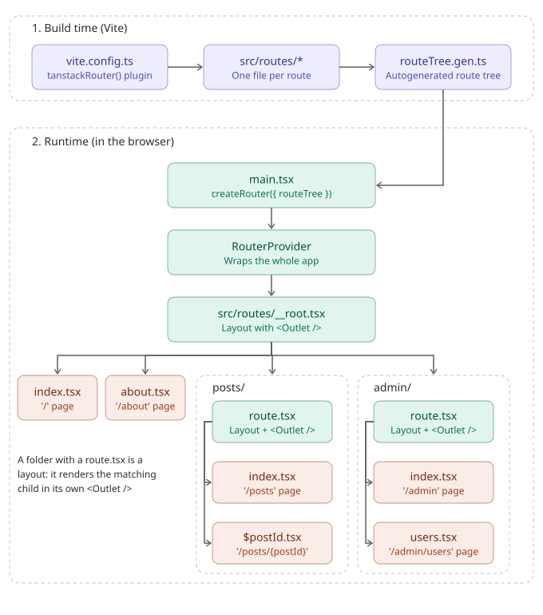

# TanStack Router demo

A small site that follows [diagram.svg](diagram.svg): from `vite.config.ts` and the generated route tree, through `main.tsx` and the root route, to plain routes and layout routes (`posts/route.tsx`, `admin/route.tsx`).

```bash
npm install
npm run dev
```


